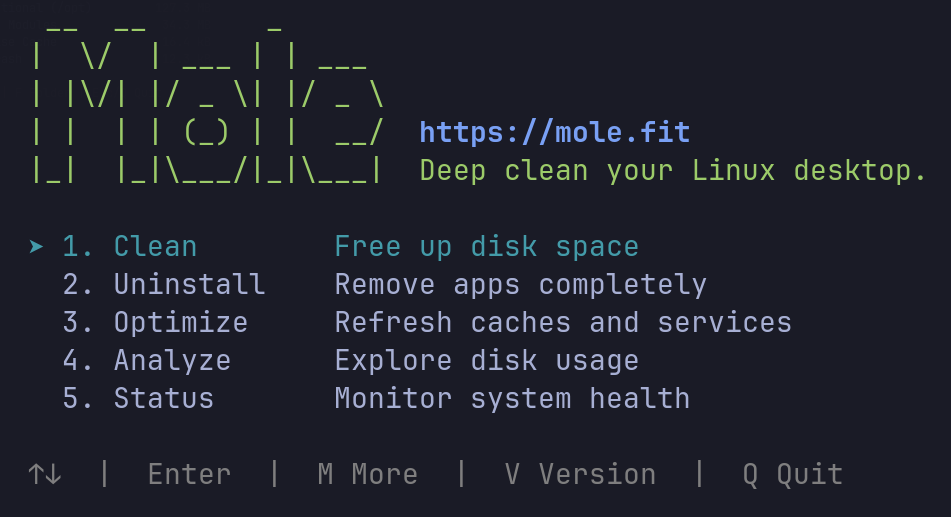
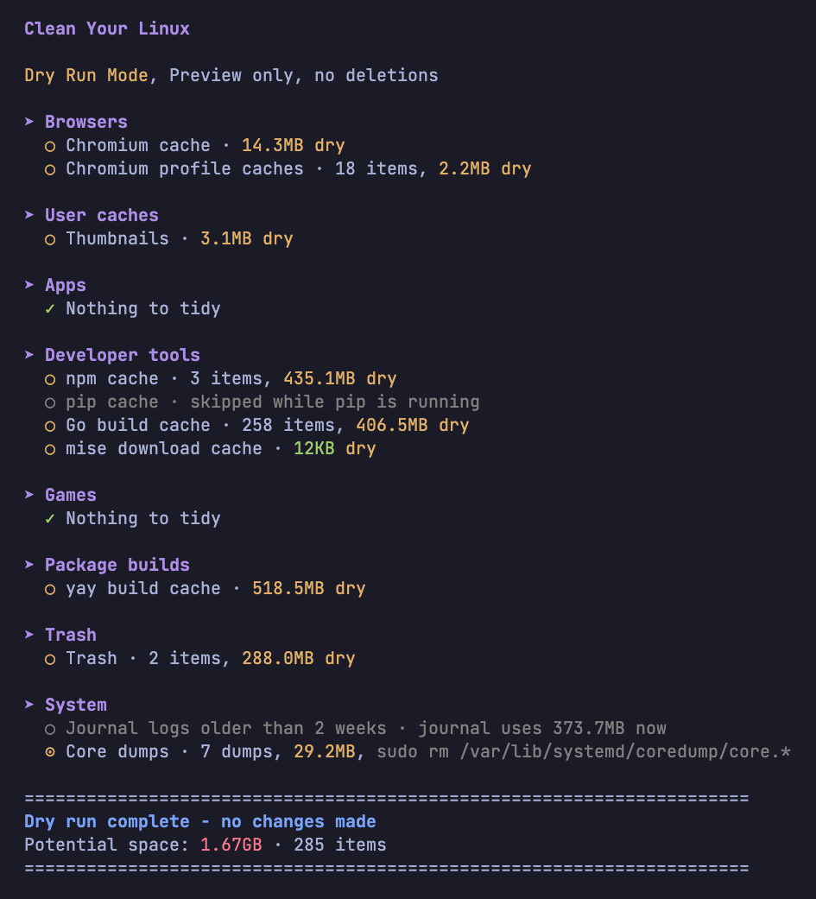
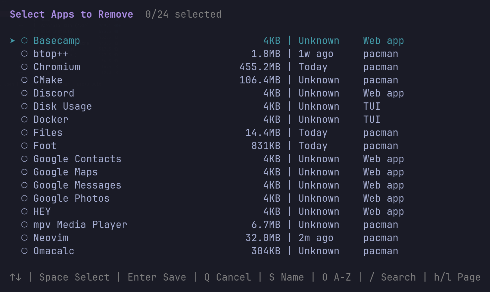
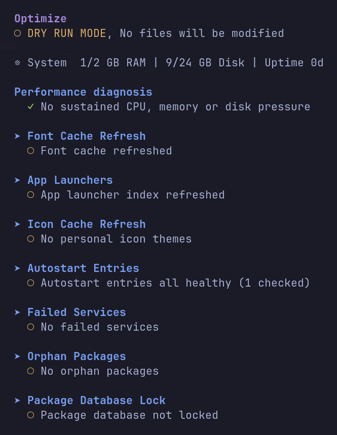
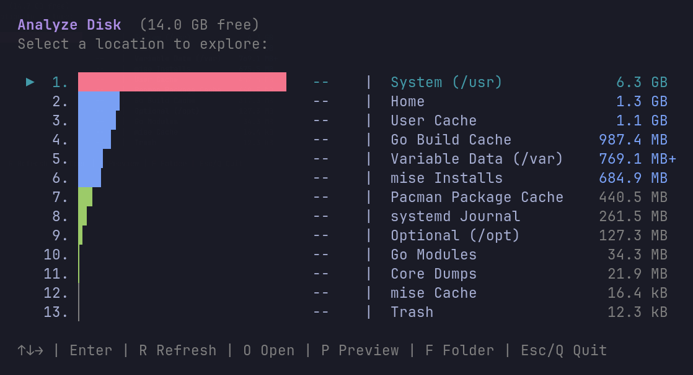
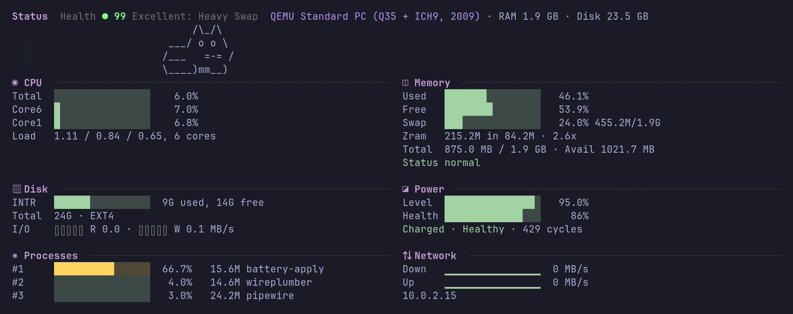

<p align="right"><a href="https://github.com/tw93/Mole#readme">macOS</a> · <a href="https://github.com/tw93/Mole/tree/windows#readme">Windows</a> · <b>Linux</b></p>

<div align="center">
  
  <h1>Mole CLI for Linux</h1>
  <p><b>Deep clean, uninstall apps, optimize, analyze disk, and monitor your Linux desktop. Free open-source CLI.</b></p>
  <a href="https://github.com/tw93/mole/stargazers"></a>
  <a href="LICENSE"></a>
  <a href="https://github.com/tw93/mole/commits/linux"></a>
  <a href="https://twitter.com/HiTw93"></a>
  <a href="https://t.me/+9f9gf4ZrFSQ2OWVl"></a>
</div>

<p align="center">
  
</p>

**Under construction.** Mole CLI for Linux is still early: the latest release is [V0.2.0-linux](https://github.com/tw93/Mole/releases/tag/V0.2.0-linux), and more lands on this branch with each version. Issues and feedback are welcome. The first target is [Omarchy](https://omarchy.org) and other Arch-based systems; on other distributions the user-level parts work and the pacman items do not appear.

This branch has its own code, written for Linux paths and tools. The look, the keys and the safety rules match the macOS CLI on the [main branch](https://github.com/tw93/Mole#readme).

## Features

- **Clean**: removes caches apps rebuild by themselves (browser and browser-profile caches, Electron apps such as VS Code, Cursor, Obsidian, Discord and Slack, Thunderbird, Telegram, thumbnails, about 50 developer tools, old versions of AI coding agents, Flatpak and Snap app caches), empties the Trash, removes unused runtimes of your own Flatpak installation, trims old pacman packages and journal logs through pacman's and systemd's own tools (on a snapper btrfs root it says the package space comes back only as snapshots rotate), and reports core dumps, container space and large caches it does not know. GPU shader caches (Mesa, NVIDIA, Steam, Lutris) go only with `mo clean --gpu-shaders`, since every game compiles them again on its next launch. Anything you want kept goes in `mo clean --whitelist`
- **Uninstall**: removes pacman, AUR and Flatpak apps, Omarchy web and terminal apps and AppImages, shows each app's size and last use, stops its background services, then moves its leftovers to the Trash, matched by the app's exact ID only and never while the app is running
- **Optimize**: refreshes the font, icon and app launcher caches, compacts browser and Thunderbird databases while they are closed, and points out failed services, launchers, autostart and Hyprland start commands whose program is gone, root-owned files in your home, orphan packages, pending `.pacnew` merges, AUR packages that need a rebuild, files no package owns, broken links in your home folder, a leftover pacman lock, TRIM switched off on an SSD and power managers that fight each other. It needs no sudo and never touches CPU, power or kernel settings
- **Analyze**: an interactive disk map of your volumes, home, caches and package cache that stays on local disks and follows btrfs subvolumes; deleting from it moves items to the Trash
- **Purge**: removes build output of projects you have not touched for a week (`node_modules`, `target`, `build`, `.venv` and about 30 others), only next to the project file of the tool that rebuilds it, never with files git tracks inside and never while a program works in that project
- **History**: lists what Mole removed, moved to the Trash or skipped, by run, with `--json` for scripts
- **Status**: live CPU, memory pressure and zram, disks, network, temperatures, GPU, battery and power draw, peripherals, btrfs allocation and the busiest apps with their GPU memory, with a health score

## Install

```bash
curl -fsSL https://raw.githubusercontent.com/tw93/Mole/linux/install.sh | bash
```

Mole installs into `~/.local/share/mole` and links `mo` into `~/.local/bin`. It needs no sudo to install and runs as your own user; the only steps that ask for sudo are `paccache` and `journalctl` in `mo clean` and the package removal in `mo uninstall`, and pacman keeps its own confirmation there.

```bash
mo update          # install the latest release
mo update --force  # reinstall it
mo remove          # remove Mole and its own files
```

## Usage

```bash
mo                         # main menu
mo clean                   # clean caches and the Trash
mo clean --dry-run         # preview, nothing removed
mo clean --whitelist       # choose what clean keeps
mo uninstall               # pick apps to remove
mo uninstall --list        # apps and the names mo uninstall accepts
mo uninstall --dry-run zoom
mo optimize                # refresh caches and check the system
mo optimize --dry-run      # preview
mo analyze                 # disk map
mo analyze /mnt/data
mo status                  # live system status
mo status --json           # one machine-readable snapshot
mo purge                   # pick project build output to remove
mo purge --dry-run         # preview
mo purge --paths           # folders purge scans
mo history                 # what Mole changed, by run
mo history --json
```

In the menus: arrow keys or `j`/`k` to move, `Space` to select, `Enter` to confirm, `/` to filter, `q` to quit.

## Safety

- Files you could want back go to the freedesktop Trash, with a `.trashinfo` so your file manager can restore them. Only caches from a fixed list are removed directly, since moving a cache to the Trash frees nothing.
- A cache is skipped while the app that owns it is running, and when Mole cannot tell whether it runs.
- Uninstall leftovers are matched by the app's exact ID, never by part of a name. Caches are selected by default; settings and data are not, and browser profiles are never preselected.
- Mole refuses to run as root, never removes system folders, mount points or other users' files, and never runs `pacman -Scc`, `--noconfirm` or `autoremove`.
- Purge removes build output directly, after checking each folder again right before it goes: still the same folder, below the project folder through real folders only, yours, and not a mount point.
- Every change is written to `~/.local/state/mole/operations.log`, and `mo history` reads it back.

## Features in Detail

The screenshots below come from an Omarchy test machine. Available items and sizes depend on your system.

### Clean

```bash
mo clean --dry-run
```



Caches whose app is running are skipped and named. Large folders under `~/.cache` that Mole does not know are listed under Not cleaned, never removed.

### Uninstall

```bash
mo uninstall
```



Lists pacman, AUR, Flatpak, AppImage, Omarchy web and terminal apps with their size and last use. Picked apps are removed by their own package manager, with its own confirmation, and their leftovers go to the Trash. `mo uninstall --dry-run` shows everything that would happen without running anything.

### Optimize

```bash
mo optimize --dry-run
```



Anything that needs root or a choice from you, such as a failed service or orphan packages, is reported with the command to run.

### Analyze

```bash
mo analyze
mo analyze /mnt/data
```



An interactive disk explorer with the same layout as the macOS version. Network, FUSE and container mounts are shown but not scanned.

### Status

```bash
mo status
```



A live dashboard with a health score, CPU, memory, disk, power, network, and the busiest apps, with processes grouped by app. `mo status --json` prints one snapshot for scripts.

### Purge

```bash
mo purge
mo purge --paths
```

Scans `~/www`, `~/dev`, `~/Projects`, `~/code` and similar folders, plus any home folder that holds a project, or only the folders listed in `~/.config/mole/purge_paths`. Folders changed in the last 7 days and projects a program works in start unselected; the rest start selected. Outside a terminal, `--yes` removes only what is older than 7 days.

## Community

Thanks to everyone who helped build Mole. Go follow them. ❤️

<a href="https://github.com/tw93/Mole/graphs/contributors">
  
</a>

## Support

- If Mole helped you, give it a star, [share it](https://twitter.com/intent/tweet?url=https://github.com/tw93/Mole/tree/linux&text=Mole%20-%20Deep%20clean%20your%20Linux%20desktop.), or open an issue or PR
- Contributions are welcome; read [CONTRIBUTING.md](CONTRIBUTING.md) first
- I have two cats, TangYuan and Coke, and if Mole makes your life a little easier, feel free to treat them to <a href="https://cats.tw93.fun?name=Mole" target="_blank">canned food 🥩</a>

## License

Mole is open source under GPL-3.0; see [LICENSE](LICENSE). Any modified version you share must remain under the same license. If you fork Mole, please use a distinct name and credit Mole as the upstream source; see [TRADEMARK.md](TRADEMARK.md).
